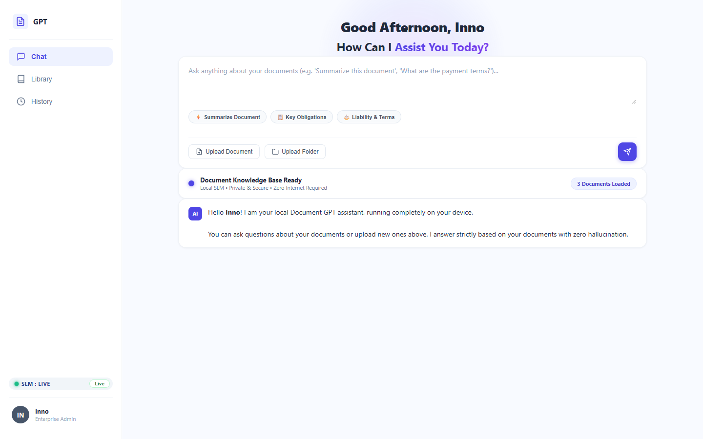
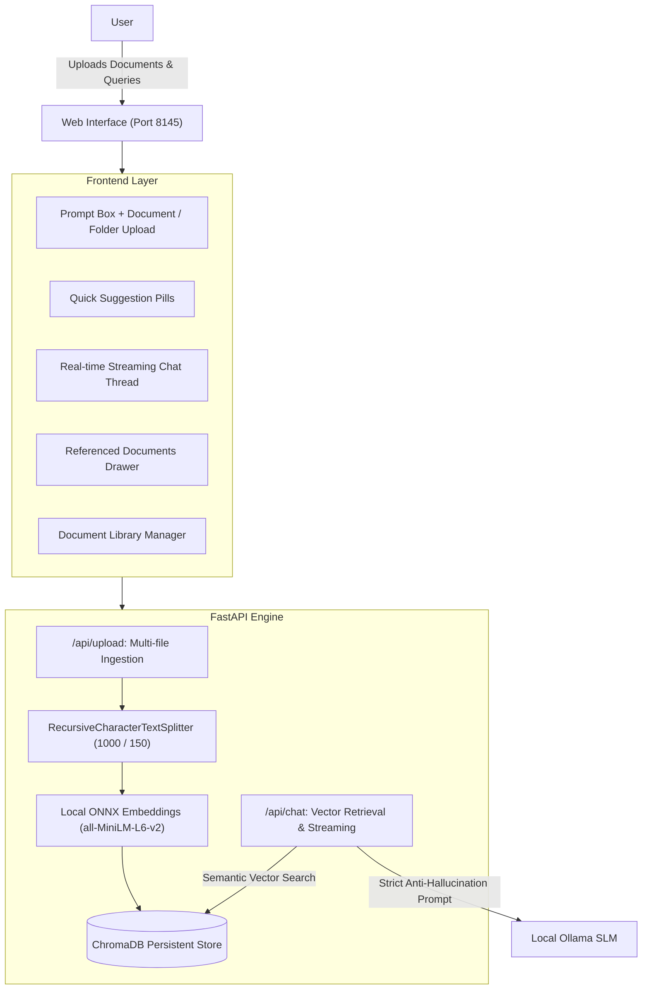

# Local Document GPT 🤖

<div align="center">


**A 100% private, on-device ChatGPT for your personal documents.**  
*Zero cloud dependencies • Zero telemetry • Grounded with strict anti-hallucination*

<br/>



</div>

---

## 📖 Table of Contents

- [Overview](#-overview)
- [Key Features](#-key-features)
- [System Architecture](#-system-architecture)
- [Quick Start](#-quick-start)
- [Project Structure](#-project-structure)
- [REST & Streaming API](#-rest--streaming-api)
- [Credits & Reference](#-credits--reference)
- [License](#-license)

---

## 🌟 Overview

**Local Document GPT** allows you to upload, index, and converse with your documents directly from your local machine. Built following the core Retrieval-Augmented Generation (RAG) principles outlined in [Aman Kharwal's reference guide](https://amanxai.com/2026/08/02/create-a-chatgpt-for-your-personal-documents/), the app pairs a high-performance vector pipeline with an intuitive web interface.

No API keys are required. All embeddings, vector storage, and language model inference run entirely on your local CPU / GPU.

---

## ✨ Key Features

- **🔒 100% Offline & Private**: Documents never leave your device. All files and semantic vectors reside in your local directory.
- **📄 Multi-Format Ingestion**: Supports `.pdf`, `.docx`, `.txt`, `.md`, and `.csv` files as well as entire directories.
- **🧠 Semantic Text Chunking**: Employs `RecursiveCharacterTextSplitter` (`chunk_size=1000`, `chunk_overlap=150`) to maintain context across sentence boundaries.
- **⚡ On-Device Vector Store**: Uses persistent [ChromaDB](https://www.trychroma.com/) with fast local `all-MiniLM-L6-v2` ONNX embeddings.
- **🦙 Local SLM Inference**: Integrates directly with [Ollama](https://ollama.com/) (`qwen2.5:1.5b`, `gemma4:e4b`, `mistral`, or any model of your choice).
- **🛡️ Strict Anti-Hallucination Guardrails**: The assistant is grounded strictly in retrieved context. If an answer cannot be verified from the document, it explicitly states: *"I couldn't find that information in the document."*
- **📚 Verified Context Citations**: Each generated response cites the exact document title and page number used.
- **💬 Real-Time Streaming UI**: ChatGPT-style fluid typewriter token streaming with markdown formatting, code snippets, and quick suggestion prompts.
- **📁 Document Library**: Easily view loaded files, page counts, file sizes, and delete or refresh indexes.

---

## 🏗️ System Architecture



---

## 🚀 Quick Start

### 1. Prerequisites

- **Python 3.10+**
- **Ollama**: Download and install from [ollama.com](https://ollama.com/)
  ```powershell
  # Pull your preferred local model
  ollama pull qwen2.5:1.5b
  ```

### 2. Clone the Repository

```bash
git clone https://github.com/chaudhary9090/local-gpt.git
cd local-gpt
```

### 3. Install Dependencies

```powershell
pip install -r requirements.txt
```

### 4. Launch the Application

```powershell
python run.py
```
*Or double-click `start.bat` on Windows.*

### 5. Open Your Browser

Navigate to:
👉 **[http://127.0.0.1:8145](http://127.0.0.1:8145)**

---

## 📂 Project Structure

```
local-gpt/
├── backend/
│   ├── __init__.py
│   ├── main.py          # FastAPI application & REST endpoints
│   └── rag_engine.py    # ChromaDB loader, splitter, embeddings & Ollama client
├── frontend/
│   ├── index.html       # Clean, modern single-page dashboard
│   ├── css/
│   │   └── style.css    # Responsive UI styling & chat components
│   └── js/
│       └── app.js       # Streaming reader, file uploader, and state logic
├── data/
│   ├── docs/            # Storage folder for uploaded documents
│   └── chroma_db/       # Persistent on-device vector database
├── assets/
│   └── screenshot.png   # Application preview screenshot
├── run.py               # Main launcher script (starts server on port 8145)
├── start.bat            # One-click Windows startup script
├── requirements.txt     # Python package requirements
├── .gitignore
└── README.md
```

---

## 🔌 REST & Streaming API

| Method | Endpoint | Description |
| :--- | :--- | :--- |
| `GET` | `/api/status` | Returns local SLM health, active model, and document counts |
| `GET` | `/api/documents` | Lists all indexed documents, page counts, and sizes |
| `DELETE` | `/api/documents/{filename}` | Removes document and its vector embeddings from ChromaDB |
| `POST` | `/api/upload` | Multipart upload for one or multiple files / directory |
| `POST` | `/api/chat` | Performs semantic search and streams SSE tokens with citations |
| `POST` | `/api/settings` | Updates active model and chunking hyperparameters |
| `POST` | `/api/retrain` | Drops and re-indexes all documents in `./data/docs/` |

---

## 🙏 Credits & Reference

- Inspired by the local document RAG tutorial by **Aman Kharwal**: [*Create a ChatGPT for Your Personal Documents*](https://amanxai.com/2026/08/02/create-a-chatgpt-for-your-personal-documents/).
- Powered by [LangChain Text Splitters](https://github.com/langchain-ai/langchain), [ChromaDB](https://github.com/chroma-core/chroma), and [Ollama](https://github.com/ollama/ollama).

---

## 📄 License

This project is licensed under the [MIT License](LICENSE).
